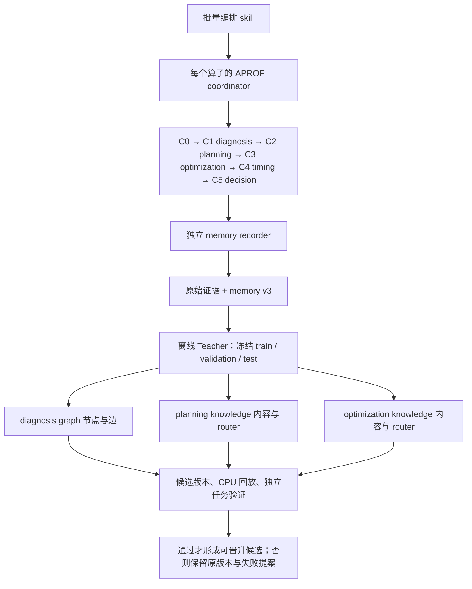

# APROF 优化采集与离线学习脚手架

新任务从两个高层 skill 进入。单算子的诊断、规划、实现和计时仍由选定 skill-lib 的 coordinator 管理；脚手架负责多任务组织、独立整理 memory，以及任务结束后的知识更新。

| 入口 | 输入 → 交付 |
| --- | --- |
| [aprof-optimize-batch](skills/aprof-optimize-batch/SKILL.md) | 多个算子任务、固定 skill-lib、预算 → 各任务的代码/结果、完整 memory、批次索引 |
| [aprof-train-knowledge](skills/aprof-train-knowledge/SKILL.md) | 冻结的 memory 集合、基础知识版本 → 三个知识区的局部修订、参数覆盖、验证报告 |
| [共享契约](contracts/README.md) | batch、task-result、memory v3、knowledge-update 的身份、引用与校验 |
| [CANNBench](benchmarks/cannbench) | 算子工程、oracle、workload、固定 train/validation/test 成员 |



两个 skill 是本仓库的上层研究能力，不安装进算子使用的 skill-lib 包。registry 在 [skills/registry.json](skills/registry.json)。本轮提供操作规范、严格记录格式和 CPU 完整性校验；调度由宿主 agent 执行，Teacher 按 skill 编辑候选。没有新增自动训练服务，也没有运行硬件、更新知识权重或发布版本。

## 文件夹治理

| 当前路径 | 归属和处置 |
| --- | --- |
| `skills/` | 两个新高层入口，分别拥有编排/recorder 和 Teacher 参考资料 |
| `contracts/` | 两个入口共用的记录规范；不复制 skill-lib 的 C1/C2/C3 schema |
| `benchmarks/cannbench/` | 保留全部算子、输入生成、oracle、task_specs、split；旧 harness 有自身协议，新批次计时调用选定 skill-lib |
| `tools/` | 保留安装/发布/registry/证据工具；新增记录校验器。工具兼容不意味着其旧流程成为新主入口 |
| `tests/` | 保留历史兼容测试；新契约测试与旧 runtime 分开验证 |
| `collection/` | 现有 172 个 Python 脚本及配置是历史采集、恢复、归档和协议回放实现。停止将其 workflow 作为 1.1.0 新任务入口；按明确旧运行调用 |
| `curation/` | 保留 1.0.0 Teacher/Wiki 审计与历次计时试验回执，不作新 Teacher 的活动知识目录 |
| `evidence/` | 保留历史精简证据及 hash；导入为历史材料时保留原协议、缺项和 split，不能自动获得新训练资格 |
| `docs/` | 发布记录、迁移与研究背景；新流程规范归两个 skill，旧 training_roadmap 标记历史 |
| `benchmarks/aprof_benchmark`、`aprof_injected_ops`、`benchmarks/tools` | 历史/可选的注入与工具验证；不加入默认自然算子批次，隐藏注入标签不进入在线路由 |
| `third_party/` | 仅历史来源定位；新任务运行不依赖外部 cannbot checkout |

这里采用**活动入口收敛、历史路径保留**：旧 producer 及证据引用包含路径和 hash，直接搬走脚本或改写旧协议会破坏回放。旧字节继续留在原处，后续逐个迁移必须有调用者与回放验证；不建立一份重复的活动副本。CANNBench 现有 49 个实体算子工程保持不变。

1.2.0 新任务产生的工作区、源码快照、原始 CSV 和大型证据放 `/dev/shm/aprof-<task-id>`，不自动回写共享盘；历史版本按其冻结协议回放。Git 维护 skill、契约、工具和脱敏的小型验证材料。运行目录布局与归档闭包见 [memory 规范](skills/aprof-optimize-batch/references/memory.md)。

## CPU 检查

```bash
python3 -m pip install -r scaffolding/tools/learning-requirements.txt
python3 scaffolding/tools/validate_learning_records.py --root /absolute/bundle --kind memory --input memory.json
python3 -m pytest scaffolding/tests/test_learning_records.py -q
```

`--root` 是所有新引用的共同根；校验器只读，不执行记录中的命令。检查通过表示格式、文件 hash、角色、候选覆盖和版本关联可用，**不代表硬件证据已重放或知识可以晋升**。Teacher 的验证职责见 [学习门槛](skills/aprof-train-knowledge/references/admission.md)。

1.1.0 runtime 0.2.6 已纳入 [original_python_v1](../skill-libs/graph-base/1.1.0/skills/ascendc-aprof-profiling/references/original-oracle.md)，通过冻结原程序保留 exp / sigmoid 的 BF16 和自定义误差规则；完整配置能力预检与实际输出验证仍是独立步骤。1.2.0 新任务使用软目标与本地工作区，版本边界及执行入口见 [维护说明](../MAINTENANCE-1.2.0.md)。旧演练和归档的缺项状态不因源码更新而改变。

## 1.3.1 开发材料归档

七组回归、评测和维护材料及两个离线回放入口已移至[开发归档](curation/graph-base-1.3.1-development/README.md)。运行时保留在独立的 graph-base 1.3.1 包中；归档不参与日常加载。
