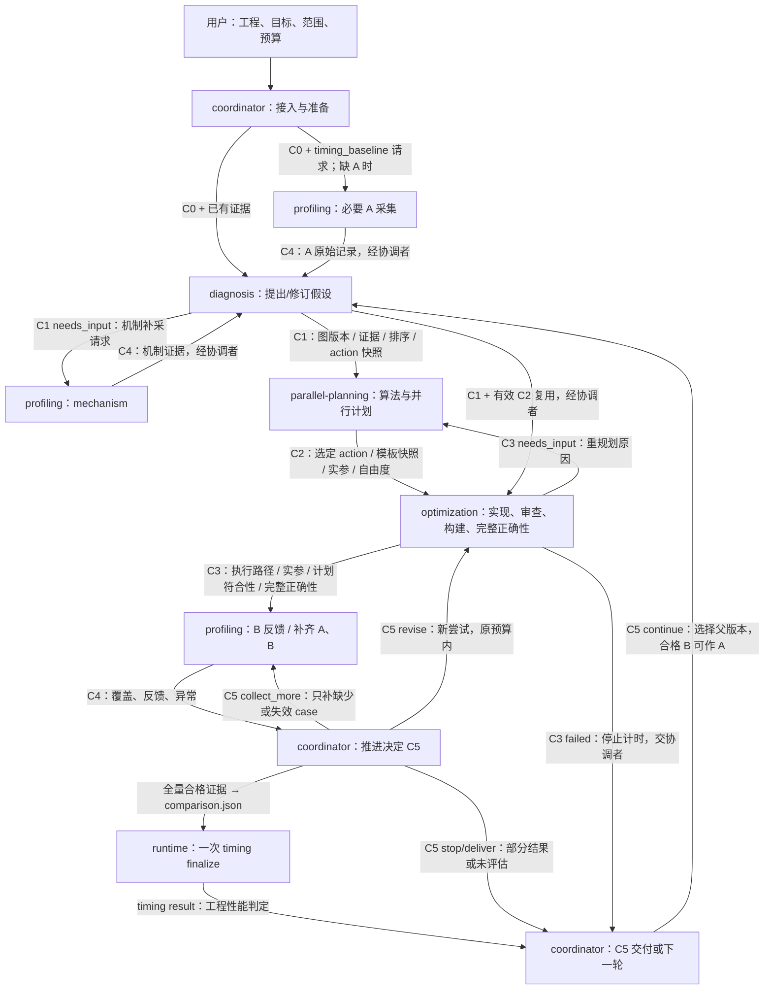

# AProf workflow：角色阶段与 contract

本文件是 1.1.0 的完整编排定义。默认一个协调者围绕一个假设实现一个候选；可以由同一 Agent 承担多个角色，也可以委派。执行角色的输入输出使用 [公共交接契约](contracts/common.md)，专业 skill 负责具体方法。

## 角色与唯一契约

| 角色定义 | 负责的阶段 | 接收 | 返回 |
| --- | --- | --- | --- |
| [coordinator](agents/coordinator.md) | 接入、分派、推进、runtime 收尾、交付 | 用户任务和各阶段结果 | C0 preparation、各阶段请求、C5 decision |
| [diagnosis](agents/diagnosis.md) | 诊断和补证据后再分析 | C0、源码/workload、已有 C4 | C1 diagnosis（图/证据/动作快照） |
| [parallel-planning](agents/parallel-planning.md) | 算法、并行与分发规划 | C0、C1、架构/旧计划 | C2 planning（模板/参数/方案比较） |
| [optimization](agents/optimization.md) | 实现、审查、构建、完整正确性 | C0、C1、C2、合法路由与父版本 | C3 candidate（执行路径/参数调整/符合性） |
| [profiling](agents/profiling.md) | 基线/候选计时、机制采集 | C0/C3、同源正确性、采集请求；机制还需 C1 | C4 profiling |

| 标记 | 阶段 contract | 关键交接内容 |
| --- | --- | --- |
| C0 | [preparation](contracts/preparation.md) | 范围、工程/父版本、环境、workload/oracle、完整声明、准备与预算 |
| C1 | [diagnosis](contracts/diagnosis.md) | 主假设、事实/反证、未知谓词、补采需求 |
| C2 | [planning](contracts/planning.md) | 架构、并行/分发 JSON、适用域、复用/重规划条件 |
| C3 | [candidate](contracts/candidate.md) | 候选源码/二进制、dispatch、审查/构建/完整正确性、采集配置 |
| C4 | [profiling](contracts/profiling.md) | 目的、实际覆盖、新采/复用、原始记录、解析与异常 |
| C5 | [decision](contracts/decision.md) | 比较与覆盖、机器结果或未评估、下一步、成本和交付 |

C0—C5 标识阶段；外层 Markdown 保持 contract_version=1，C1/C2/C3 新机器记录使用 aprof.handoff/v2 的 stage 字段。每次调用都有独立 stage_id；C4 可产生多个实例，分别用于 A、B、机制、补齐或复验。有效 C0/C1/C2/C4 按引用复用，不要求每轮生成六份新报告。

## 角色与 contract 连线

图中跨角色箭头都表示协调者核对并转交文件，执行角色不会自行串调其他 Agent。箭头上的 C0—C5 对应上表；机器比较请求和 timing result 保持现有 JSON 格式。

## 阶段推进

### 1. coordinator 接入 → C0

先读取用户已有信息，冻结原始源码、完整 workload、输入/oracle、实际设备/工具链、执行范围和预算。当前主要覆盖 910C/A3 Vector 场景；实际架构不能只由 DAV_2201 推断。

基线只读，候选放隔离工程。只有 kernel 时调用直调技能。执行优化前组织构建与完整正确性，确认 native adapter 的完整调用、真实 L2 驱逐和输出路径。通用采集器不自动翻译任意 host 或 oracle。

预声明完整 timing/correctness case、代表/回归集、比较父版本和复用/复验规则。已有有效 A 直接引用；没有则由 profiling 按 C0 请求必要 case，扩展时再补齐。单次设备分配、输入准备、传输和输出检查在目标计时外。

采集与已有计划仍用原 Context；图/知识树另用 aprof.evidence/v1 快照，关联原 Context hash，不向旧严格 schema 增字段。仅诊断/规划任务按允许范围准备，不能把未执行项写成 passed。

### 2. diagnosis 接收 C0/C4 → C1

根据源码、workload 和已有证据选择本轮假设，保留替代解释与反证。只沿 diagnosis/graph/GRAPH.md 读取匹配症状、问题与动作；保存 v0003 路由与动作内容快照。

缺失机制证据会改变选择，或合法图路由需要 profile 谓词时，C1 返回 needs_input 与精确补采请求。协调者调用 profiling 的 mechanism，再将 C4 交回新的 diagnosis 实例。未实现 extractor 保持未知，源码故事或计时改善不能补造谓词。

没有合法动作时记录 needs_evidence/NOOP。用户明确授权的图外实验单独保留证据，不能伪造图边、episode 或奖励。

### 3. parallel-planning 接收 C0/C1 → C2，或直接复用有效 C2

核验架构、算法、任务所有权、归约/同步、workspace、workload 分组与 fallback。普通 tile、buffer、搬运、流水调参继承有效计划；每个候选仍重新绑定 dispatch 实现源码身份。

改变全局算法、分解、所有权、归约、同步或 workspace 所有权时重新规划，使用 optimization_stage=algorithm_parallel；其余为 execution。C2 引用真实 architecture/parallel/dispatch JSON 及校验回执，不把书面选择当成收益证明。

### 4. optimization 接收 C0/C1/C2/路由 → C3

读取 C2 的选定 action、模板快照、实例参数与实现自由度；通过执行知识树记录实际采用的路径和版本。v0003 不产生旧路由行为概率。在隔离工程实施一个意图，完成静态审查、构建和完整声明正确性，覆盖其他 workload group、边界和 fallback。

C3 只有在审查、构建、完整正确性和采集准备齐备后才可进入候选计时。首个强制失败即返回 failed，保留失败与成本；缺少前置条件或需重规划返回 needs_input。修复/新候选另开实例，不覆盖旧记录。

### 5. profiling 接收 C0/C3/请求 → C4

新计时唯一方法为 [single_role_l2_clean_task_v1](../skills/ascendc-aprof-profiling/references/unified-timing.md)：每 case/实现一个新进程、5 次预热、20 次逐轮清 L2 的完整调用，逐轮全部目标 Task 求和后按预声明异常策略取中位数；新任务使用 `bounded_outlier_v1`，原始 20 次和剔除明细全部保留。

复用有效 A，只采 B；先看预声明代表/回归集。需要完整结论时，协调者用 C5 请求 C4 只补缺少 case。合格采集直接进入全量收尾，不因“正式”标签重采。

采集 artifact 不绑定永久 A/B 角色，上轮 B 可在匹配条件下作新 A。过期、设备变化、噪声或临界结果按预声明规则使用同方法更新/复验，保留全部尝试，不择优挑进程。

mechanism 请求遵守独立 PMU 来源和统计要求；其结果用于诊断，不计入性能计时样本。模拟数据只作代理证据。缺新方法支持时返回具体缺项，不回退旧 v5/Event。

### 6. coordinator 接收 C3/C4 → runtime → C5

代表集 C4 completed 仅表示该请求完成。只有完整 timing 集的两侧记录、完整 correctness 和原始回执齐备，才创建 comparison 并调用一次 timing finalize。

runtime 回放原始来源、输出、完整调用和复用条件，计算各 case 中位数、轮内 CV、回归及等权几何平均加速比。工程目标为 speedup≥1.03、任一 case 回归≤3%、保留样本轮内 CV≤5%、异常最多 2/20；旧 declaration 未启用异常策略时保持原始 CV 判据。这是点估计，没有旧配对 95% 下界承诺。

C5 引用 accepted/rejected/inconclusive；未收尾写 not_evaluated 和覆盖/缺项。不要再串行执行旧 candidate gate → episode finalize。新结果为 performance_engineering_only，不自动授予机制归因、生产 best 或策略奖励。语义、范围、可移植性与合法路由继续按各自契约核验。

### 7. coordinator 用 C5 交付或继续

交付候选代码及简短中文报告，写明实际父版本、原始基线、协议、覆盖、机器结果、成本与未解决项。仅诊断/规划任务交付相应 C1/C2，不要求候选或计时产物。

继续时明确新的父版本和复用对象；准备与未变计划不重做，变更候选重新做完整正确性。失败回到上一有效父版本，保留所有尝试，不把不同协议或时段的加速比相乘。

## 分支与交接规则

| 返回或条件 | 协调者的下一步 |
| --- | --- |
| C1 needs_input：缺可采机制证据 | 带精确需求发 C4 mechanism，再将结果返回 diagnosis |
| 未实现谓词 / 没有合法图动作 | 保持未知、needs_evidence 或 NOOP，不伪造路径 |
| 有效 C2 | 直接引用并进入 optimization；每个候选重绑实现 |
| C3 needs_input：计划边界改变 | 先发新的 C2，再恢复候选实现 |
| C3 failed：构建/正确性失败 | 保留回执，停止该候选计时，原预算内决定修复或结束 |
| C4 failed 或 needs_input | 保留部分产物和具体原因，不进入依赖该证据的收尾 |
| C4 代表集完成、仍缺 case | 决定停止或 collect_more，只补缺少/失效记录 |
| 全量结果 rejected / inconclusive | 原样保留；按预声明规则决定修订、复验或停止 |
| 工具/授权缺失或预算不足 | 返回已验证计划、已有证据和缺项，不更换旧协议或续期 |

生成、审阅、构建、正确性、采集、导出、解析、在线核验共用原任务预算；预算按到达阶段的候选次数计数，不按预热或采集轮次。每次调用传原截止时间，记录实际 token 和墙钟成本。启动前预留完成采集与回放的时间。

工作区、复用失效条件、任务命令、归档和清理只在 [生命周期](references/workflow-details.md) 维护。机器接口见 [runtime 契约](references/runtime-contracts.md)。这些 contract 明确 Agent 的执行约定，runtime/task run 仍是工具与进程监督器，不是自动完成整场优化的调度器。

## 三个知识区的职责边界

诊断图回答“观测支持什么机制、什么变换值得检验”；规划树回答“选择何种算法/并行方案、为什么、如何实例化”；执行树回答“如何在已定方案内正确实现”。C1→C2→C3 传递必要内容快照，后续角色不重新读取前一角色内部目录。所有角色由 coordinator 通过 contracts 串联。C4/C5 只关联真实执行与计时结果，不把推荐、选择、执行混成训练信号。

十二项辅助技能与触发角色见 [能力登记](../skills/registry.json)，按需调用，不增加固定必经阶段。
