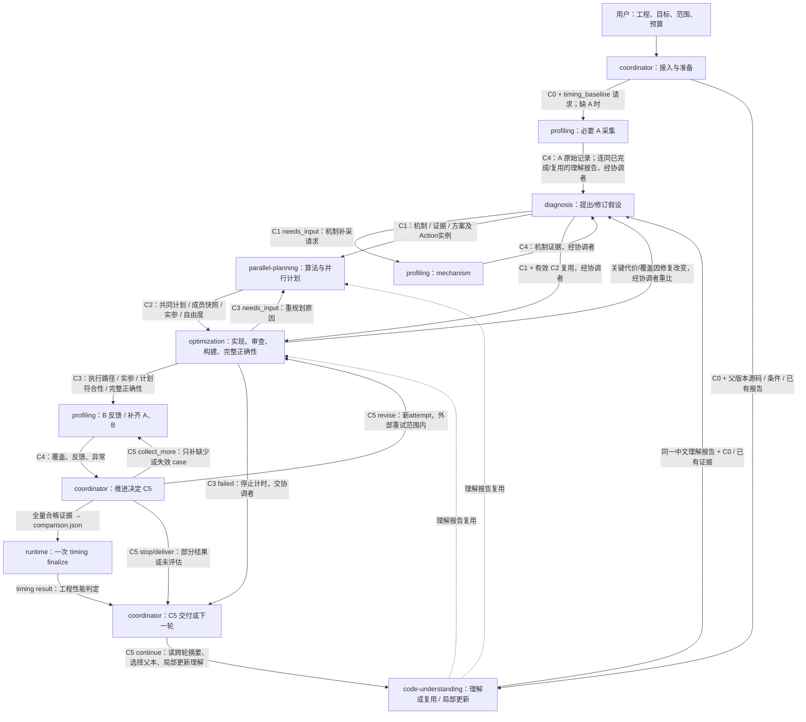

# AProf workflow：角色阶段与 contract

新任务必须按 [soft_targets_local_v1](references/execution-policy.md) 执行：耗时仅为软目标，baseline 默认 assumed，新候选完整验证一次，按全输出内容复用；所有运行产物留在 /dev/shm。

本文件是 1.3.0 的编排定义。协调者比较机制和完整方案后，每轮实施一个能完成预期变换的候选方案；可以由同一 Agent 承担多个角色，也可以委派。执行角色的输入输出使用 [公共交接契约](contracts/common.md)，专业 skill 负责具体方法。

## 角色与唯一契约

| 角色定义 | 负责的阶段 | 接收 | 返回 |
| --- | --- | --- | --- |
| [coordinator](agents/coordinator.md) | 接入、分派、推进、runtime 收尾、交付 | 用户任务和各阶段结果 | C0 preparation、各阶段请求、C5 decision |
| [code-understanding](agents/code-understanding.md) | 准备后、诊断前理解当前实现 | C0、父版本源码/workload、架构/编译条件、已有报告 | 一份中文 code-understanding 阶段 Markdown |
| [diagnosis](agents/diagnosis.md) | 诊断和补证据后再分析 | C0、理解报告、源码/workload、已有 C4 | C1 diagnosis（机制/证据/方案及成员实例快照） |
| [parallel-planning](agents/parallel-planning.md) | 算法、并行与分发规划 | C0、理解报告、C1、架构/旧计划 | C2 planning（共同计划/模板/参数/组合兼容） |
| [optimization](agents/optimization.md) | 实现、审查、构建、完整正确性 | C0、理解报告、C1、C2、合法路由与父版本 | C3 candidate（执行路径/参数调整/符合性） |
| [profiling](agents/profiling.md) | 基线/候选计时、机制采集 | C0/C3、同源正确性、采集请求；机制还需 C1 | C4 profiling |

| 标记 | 阶段 contract | 关键交接内容 |
| --- | --- | --- |
| C0 | [preparation](contracts/preparation.md) | 范围、工程/父版本、环境、workload/oracle、完整声明、准备与预算 |
| C0 → C1 之间 | [code-understanding](contracts/code-understanding.md) | 算法/数值语义、实际分派/任务/循环、所有权/布局/存储/依赖、910C 行为与关键源码定位 |
| C1 | [diagnosis](contracts/diagnosis.md) | 主假设、事实/反证、未知谓词、补采需求 |
| C2 | [planning](contracts/planning.md) | 架构、并行/分发 JSON、适用域、复用/重规划条件 |
| C3 | [candidate](contracts/candidate.md) | 候选源码/二进制、dispatch、审查/构建/完整正确性、采集配置 |
| C4 | [profiling](contracts/profiling.md) | 目的、实际覆盖、新采/复用、原始记录、解析与异常 |
| C5 | [decision](contracts/decision.md) | 比较与覆盖、机器结果或未评估、下一步、成本和交付 |

C0—C5 编号不变，code-understanding 是 C0 与 C1 之间的正式阶段，可由同一 Agent 或受委派角色完成。外层 Markdown 保持 contract_version=1；理解阶段只有这份 Markdown，不增加机器 schema 或 runtime 阶段。C1/C2/C3 新机器记录使用 aprof.handoff/v4 的 stage 字段及 action-decision/v3；旧 v2/v3 交接和 v1/v2 决策按其冻结语义回放，不混装。当前知识后继为 D v0007/P v0004/O v0007/routing v0006；历史知识快照身份保持不变。每次新调用都有独立 stage_id；C4 可产生多个实例，分别用于 A、B、机制、补齐或复验。有效 C0、理解报告、C1/C2/C4 按引用复用，不要求每轮重新生成报告。

## 角色与 contract 连线

图中跨角色箭头都表示协调者核对并转交文件，执行角色不会自行串调其他 Agent。箭头上的 C0—C5 对应上表；机器比较请求和 timing result 保持现有 JSON 格式。

## 阶段推进

### 1. coordinator 接入 → C0

先读取用户已有信息，冻结原始源码、完整 workload、输入/oracle、实际设备/工具链、执行范围和预算，传递用户/外层驱动给定的轮数、达标停止条件与重试范围。skill 不自设轮数或连续无收益停止规则；未指定多轮时只执行当前明确请求的方案并报告状态。当前主要覆盖 910C/A3 Vector 场景；实际架构不能只由 DAV_2201 推断。

基线只读，候选放隔离工程。只有 kernel 时调用直调技能。执行优化前组织必要构建并声明 baseline assumed；仅明确要求时验证 baseline，确认 native adapter 的完整调用、真实 L2 驱逐和输出路径。通用采集器不自动翻译任意 host 或 oracle。

预声明完整 timing/correctness case、代表/回归集、比较父版本和复用/复验规则。已有有效 A 直接引用；没有则由 profiling 按 C0 请求必要 case，扩展时再补齐。单次设备分配、输入准备、传输和输出检查在目标计时外。

采集与已有计划仍用原 Context；图/知识树另用 aprof.evidence/v1 快照，关联原 Context hash，不向旧严格 schema 增字段。仅诊断/规划任务按允许范围准备，不能把未执行项写成 passed。

### 2. code-understanding 接收 C0 → 一份中文理解报告

在诊断前使用 [代码理解角色](agents/code-understanding.md) 和独立 [ascendc-code-understanding](../skills/ascendc-code-understanding/SKILL.md)，按 [理解契约](contracts/code-understanding.md) 交付一份阶段 Markdown。由整体算法/数值语义，解释实际分派/任务/循环/已有策略，再串起数据所有权/布局/存储/依赖，最后映射到 910C 硬件行为；关键 host、tiling、kernel、公共函数和编译片段附源码定位与必要上下文。事实、推断、未知和实测分开说明，不以 API 碎片表或文件清单代替理解，也不预选 Problem、Action 或新的 C2 策略。

已有适用报告直接复用；性能缺测不阻断理解，不要求设备运行或新增机器产物。该报告共同交给 C1、P/O 和所有后继轮次；源码或相关条件变化时只更新受影响部分并保存后继，纯新 profiling 不重做。

### 3. diagnosis 接收 C0/理解报告/C4 → C1

先消费理解报告并核对当前父实现与适用范围，按需复核相关源码，不从头重复恢复全套实现。根据源码、workload和已有证据，联合检索Symptom邻接与完整Problem轻目录；按需读机制正文，比较支持、反证、unknown和替代解释。保存当前冻结知识身份、任务推理、Action实例与路由提示，参见[机制诊断规则](references/diagnosis-v4.md)。

新任务先按[Action 选择与反馈](references/action-selection.md)建立完整路径及 workload 分区，比较工作减少、实际覆盖和新增代价；新决策在 C1 引用 action-decision/v3，以完整方案为选择单位，不能以首个 ready 动作停止。单个 Action 足够时直接使用，多必要成员保留独立目标、条件和依赖；不得将共享工作重复计收益。详见[完整方案](references/optimization-schemes.md)。有来源且适用于当前源码的方法可作为未测收益的假设试验；性能 unknown 不自动否决。具体合法性条件缺失或必要判别尚不能完成时，C1 给出条件方案和精确补证据请求。协调者调用 profiling 的 mechanism，再将 C4 交回新的 diagnosis 实例。未实现 extractor 保持未知，源码推断或计时改善不能补造谓词。

模板不足时允许任务内临时Problem复用已注册Action，不伪造模板边。unknown可交C2条件分析，C3实施仍需满足原动作前提；临时新Action先进入提案。没有可行干预时保留解释与缺口，不强制补齐路径。

### 4. parallel-planning 接收 C0/理解报告/C1 → C2，或直接复用有效 C2

复用理解报告中的当前算法、实际路径和数据依赖，逐成员调用 P router 并形成共同计划，核验架构、任务所有权、归约/同步、workspace、workload 分组与 fallback；只补查影响本次规划的部分。共同生命周期、布局/数值要求、依赖和容量须兼容，不能把独立命中简单取并集。普通 tile、buffer、搬运、流水调参继承有效计划；每个候选仍重新绑定 dispatch 实现源码身份。

改变全局算法、分解、所有权、归约、同步或 workspace 所有权时重新规划，使用 optimization_stage=algorithm_parallel；其余为 execution。C2 引用真实 architecture/parallel/dispatch JSON 及校验回执，不把书面选择当成收益证明。

### 5. optimization 接收 C0/理解报告/C1/C2/路由 → C3

读取理解报告及C2的共同计划、各成员Action实例、实际P选择、实现边界与O路由请求；按实际改动复核受影响源码和依赖，不重做全量理解。逐成员由执行知识树选择实际recipe及组合，记录目标、参数、版本与共同兼容依据。新诊断不产生旧行为概率。在隔离工程实施完整方案，允许必要的 Host/Kernel、搬运、转换、计算、尾块及同步配套变更，不要求逐轮单因素。完成静态审查、构建和完整声明正确性，覆盖其他 workload group、边界和 fallback。

C3 只有在审查、构建、完整正确性和采集准备齐备后才可进入候选计时。首个强制失败即返回 failed，保留失败与成本；缺少前置条件或需重规划返回 needs_input。修复/新候选另开实例，不覆盖旧记录。

### 6. profiling 接收 C0/C3/请求 → C4

新计时唯一方法为 [single_role_l2_clean_task_v1](../skills/ascendc-aprof-profiling/references/unified-timing.md)：每 case/实现一个新进程、5 次预热、20 次逐轮清 L2 的完整调用，逐轮全部目标 Task 求和后按预声明异常策略取中位数；当前探索任务预声明 `median_stability_exploration_v2`／`bounded_outlier_v2`及复验额度；原始20次、处理前后统计和全部窗口保留，按同一文档区分轮内质量、中位数漂移与工程收益。旧记录继续使用原版本。

复用有效 A，只采 B；先看预声明代表/回归集。需要完整结论时，协调者用 C5 请求 C4 只补缺少 case。合格采集直接进入全量收尾，不因“正式”标签重采。

采集 artifact 不绑定永久 A/B 角色，上轮 B 可在匹配条件下作新 A。过期、设备变化、噪声或临界结果按预声明规则使用同方法更新/复验，保留全部尝试，不择优挑进程。

mechanism 请求遵守独立 PMU 来源和统计要求；其结果用于诊断，不计入性能计时样本。模拟数据只作代理证据。缺新方法支持时返回具体缺项，不回退旧 v5/Event。

### 7. coordinator 接收 C3/C4 → runtime → C5

代表集 C4 completed 仅表示该请求完成。只有完整 timing 集的两侧记录、baseline 信任声明与候选完整 correctness 和原始回执齐备，才创建 comparison 并调用一次 timing finalize。

runtime 回放原始来源、输出、完整调用和复用条件，计算各 case 中位数、轮内 CV、回归及等权几何平均加速比。工程目标为 speedup≥1.03、任一 case 回归≤3%、保留样本轮内 CV≤5%、异常最多 2/20；旧 declaration 未启用异常策略时保持原始 CV 判据。这是点估计，没有旧配对 95% 下界承诺。

C5 引用 accepted/rejected/inconclusive；未收尾写 not_evaluated 和覆盖/缺项。不要再串行执行旧 candidate gate → episode finalize。新结果为 performance_engineering_only，不自动授予机制归因、生产 best 或策略奖励。语义、范围、可移植性与合法路由继续按各自契约核验。

### 8. coordinator 用 C5 交付或继续

交付候选代码及简短中文报告，写明实际父版本、原始基线、协议、覆盖、机器结果、成本与未解决项。仅诊断/规划任务交付相应 C1/C2，不要求候选或计时产物。

每次结果、修复或重规划后更新任务根的[optimization-history.md](references/optimization-history.md)，只保留当前状态、已尝试路线、剩余机会三部分及必要引用。后继轮次先读摘要，再按需展开相关历史；分别核对实际工作/覆盖、正确性、测量和机制判断，重新比较残余机会及原方案新增代价；可以继续同 Action，也可返回 C1/C2。正确性修复不计作新的性能机制。明确新的父版本和复用对象；准备与未变计划不重做，理解报告按源码/相关条件变化仅更新受影响部分并保存后继，纯新 profiling 直接交 C1，变更候选重新做完整正确性。失败回到上一有效父版本；仅正确性通过的探索父本与已验收实现分开，保留失败、未测和未晋升尝试，不把不同协议或时段的加速比相乘。

## 分支与交接规则

| 返回或条件 | 协调者的下一步 |
| --- | --- |
| 已有适用理解报告 / 纯新增 profiling | 直接复用理解报告；新性能证据交 C1，不重做理解 |
| 源码或理解相关条件改变 | 只更新受影响部分并保留后继，再交 C1/P/O |
| C1 needs_input：缺可采机制证据 | 带精确需求发 C4 mechanism，再将结果返回 diagnosis |
| 未实现谓词 / 没有合法图动作 | 区分性能预测与实施合法性缺项，保留条件方案或知识缺口；缺证据不转换为 KEEP/NOOP，不伪造路径 |
| 有效 C2 | 直接引用并进入 optimization；每个候选重绑实现 |
| C3 needs_input：计划边界改变 | 先发新的 C2，再恢复候选实现 |
| C3 failed：构建/正确性失败 | 保留回执，停止该候选计时，外部允许的重试范围内决定修复或结束 |
| C4 failed 或 needs_input | 保留部分产物和具体原因，不进入依赖该证据的收尾 |
| C4 代表集完成、仍缺 case | 决定停止或 collect_more，只补缺少/失效记录 |
| 全量结果 rejected / inconclusive | 原样保留；按预声明规则决定修订、复验或停止 |
| 工具/授权缺失 | 返回已验证计划、已有证据和缺项，不更换旧协议 |

生成、审阅、构建、正确性、采集、导出、解析、在线核验共用原任务预算；授权优化轮次、候选 attempt 与采集样本次数分别记录：每轮围绕选定方案，修复/重试保留新 attempt 并连续计费，不通过改名扩大试验范围；不按预热或采集样本冒充优化轮次。每次调用传原始软目标时刻，记录实际 token 和墙钟成本；不足预留只警告，在已授权范围内继续必要阶段。accepted/rejected/inconclusive 保留原工程含义，是否继续另按外部任务约定判断。

工作区、复用失效条件、任务命令、归档和清理只在 [生命周期](references/workflow-details.md) 维护。机器接口见 [runtime 契约](references/runtime-contracts.md)。这些 contract 明确 Agent 的执行约定，runtime/task run 仍是工具与进程监督器，不是自动完成整场优化的调度器。

## 三个知识区的职责边界

代码理解先解释当前实现，为三个知识区提供共同输入，不预选它们的策略。诊断图回答“观测支持什么机制、什么变换值得检验”；规划树回答“选择何种算法/并行方案、为什么、如何实例化”；执行树回答“如何在已定方案内正确实现”。C1→C2→C3 传递必要内容快照，后续角色不重新读取前一角色内部目录；理解报告由 P/O 与后续轮次共同复用。所有角色由 coordinator 通过 contracts 串联。C4/C5 只关联真实执行与计时结果，不把推荐、选择、执行混成训练信号。

十二项辅助技能与触发角色见 [能力登记](../skills/registry.json)，按需调用，不增加固定必经阶段。
